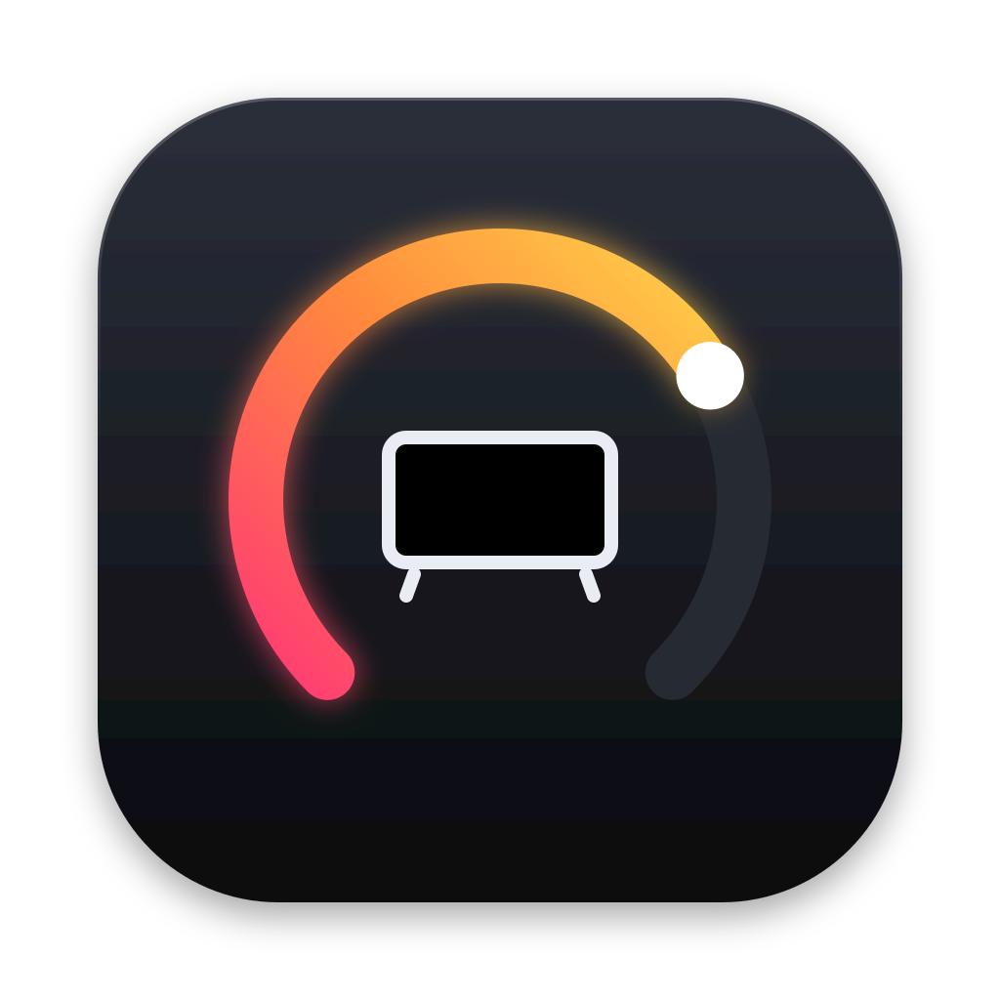

<p align="center"></p>

# OLEDial

*A dial for your LG OLED, right in the macOS menu bar.*

Control your LG webOS TV's volume, mute and OLED brightness from the Mac menu bar over your local network.

- **Liquid Glass UI** on macOS 26 Tahoe and newer, following the system Liquid Glass appearance setting. On macOS 14–15 it uses the standard translucent look.
- **Keyboard media keys:** 🔊 🔉 🔇 and ☀︎ control the TV when the pointer is on the TV's screen. You can also set them to *always* or *off*. Hold ⌥⇧ for steps of 1.
- **On-screen indicator** on the TV's screen when you change volume or brightness.
- **Custom shortcuts:** re-bind any action in Settings › Keyboard. Defaults are ⌃⌥⇧ ↑/↓ for volume, ⌃⌥⇧ →/← for brightness and ⌃⌥⇧ M for mute.
- **Easy connection:** finds TVs automatically, pairs once, and reconnects on its own, including after your Mac wakes from sleep.

Requires macOS 14 or newer. Works on Apple Silicon and Intel Macs.

## Download

Get the latest `OLEDial.zip` from the [Releases](https://github.com/jiayinh/OLEDial/releases) page.

## Installing

OLEDial isn't notarized by Apple, so macOS blocks it the first time you open it. This is expected.

1. Unzip `OLEDial.zip` and move **OLEDial.app** to your **Applications** folder.
2. Double-click it once. When macOS says *"OLEDial" Not Opened*, click **Done**.
3. Open Apple menu › **System Settings › Privacy & Security**.
4. Scroll to **Security**. Next to *"OLEDial" was blocked to protect your Mac*, click **Open Anyway** and authenticate.
5. Open OLEDial again and click **Open Anyway**. macOS remembers this choice.

> On macOS 14 Sonoma you can instead right-click the app › **Open** › **Open**.

**If macOS says the app "is damaged and can't be opened"**, or *Open Anyway* doesn't appear, run this in Terminal:
```bash
xattr -dr com.apple.quarantine /Applications/OLEDial.app
open /Applications/OLEDial.app
```

If it still won't launch, run this, then repeat the commands above:
```bash
codesign --force --deep --sign - /Applications/OLEDial.app
```

## First run

1. Click the OLEDial icon (a dial around a small TV) in the menu bar. Click **Find TVs on network**, or enter the TV's IP address, then click **Pair**. Accept the prompt on the TV.
2. Allow **Local Network** access when macOS asks.
3. To use the keyboard keys, open Settings › Keyboard › **Grant Access…** and turn on *OLEDial* under Privacy & Security › **Accessibility**.
4. If the TV isn't detected as a display, choose it under Settings › General › **TV display**.

## Updating

After installing a new version, macOS treats it as a new app for Accessibility. In System Settings › Privacy & Security › Accessibility, select OLEDial, click **−** to remove it, then turn it on again via Settings › Keyboard › **Grant Access…**. You may also need to repeat the [Installing](#installing) steps.

## Troubleshooting

- **Media keys stopped working after an update:** see [Updating](#updating).
- **Keys still change the Mac's volume:** check that Accessibility is granted, the right TV display is selected, and the pointer is on the TV's screen.
- **Can't connect while the TV is off:** on the TV, turn on *TV On With Mobile* / *Wake on LAN* (usually Settings › General › Devices › External Devices; the path varies by model).
- **Brightness slider missing:** some picture modes and Energy Saving settings lock OLED brightness. This varies by model and firmware.
- **Volume does nothing:** if the TV's sound goes to a soundbar over optical, or over ARC without CEC volume control, the TV can't control the volume.
